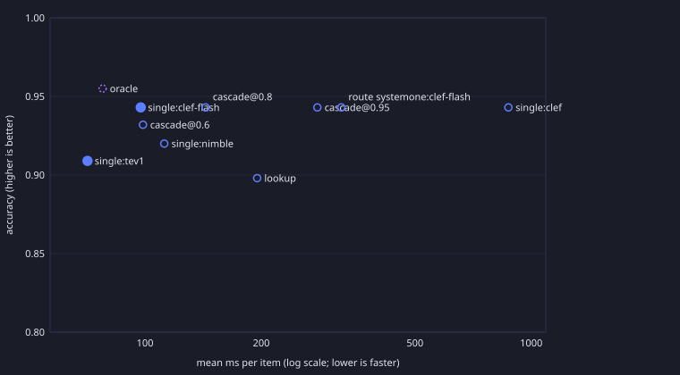

# Router benchmark (20261030-064003)

Router `systemone:clef-flash` choosing among tev1, clef-flash, nimble, clef on clockwork-grocery-type, clockwork-invest-category, clockwork-listen-category, clockwork-read-category, clockwork-shopping-type, clockwork-todo-category, clockwork-watch-category. Scored on held-out items only; profiles shown to the
router come from dev items. Latency is composed from each call's measured time: a
routed item costs the router call plus the chosen model's call, a cascade item costs
every call it made. `*` marks strategies no other beats on both accuracy and mean latency.

| Strategy | n | accuracy | macro F1 | mean ms | median ms | p90 ms | |
|---|---|---|---|---|---|---|---|
| single:tev1 | 88 | 0.91 | 0.87 | 71.0 | 72.1 | 104.5 | * |
| oracle | 88 | 0.95 | 0.94 | 77.7 | 72.3 | 104.7 |  |
| single:clef-flash | 88 | 0.94 | 0.92 | 97.5 | 77.9 | 139.0 | * |
| cascade@0.6 | 88 | 0.93 | 0.92 | 98.8 | 74.1 | 107.2 |  |
| single:nimble | 88 | 0.92 | 0.90 | 112.2 | 99.6 | 159.5 |  |
| cascade@0.8 | 88 | 0.94 | 0.93 | 143.5 | 75.0 | 219.7 |  |
| lookup | 88 | 0.90 | 0.86 | 195.2 | 75.3 | 1132.2 |  |
| cascade@0.95 | 88 | 0.94 | 0.92 | 279.4 | 82.3 | 1294.9 |  |
| route:systemone:clef-flash | 88 | 0.94 | 0.92 | 322.2 | 177.2 | 249.8 |  |
| single:clef | 88 | 0.94 | 0.92 | 872.5 | 725.1 | 1376.7 |  |

## Accuracy by task

| Strategy | clockwork-grocery-type | clockwork-invest-category | clockwork-listen-category | clockwork-read-category | clockwork-shopping-type | clockwork-todo-category | clockwork-watch-category |
|---|---|---|---|---|---|---|---|
| single:tev1 | 1.00 | 0.83 | 0.90 | 0.88 | 0.88 | 1.00 | 0.75 |
| oracle | 1.00 | 0.83 | 1.00 | 1.00 | 0.94 | 1.00 | 0.88 |
| single:clef-flash | 1.00 | 0.83 | 0.90 | 1.00 | 0.94 | 1.00 | 0.88 |
| cascade@0.6 | 1.00 | 0.75 | 1.00 | 1.00 | 0.88 | 1.00 | 0.88 |
| single:nimble | 1.00 | 0.75 | 0.90 | 1.00 | 0.88 | 1.00 | 0.88 |
| cascade@0.8 | 1.00 | 0.75 | 1.00 | 1.00 | 0.94 | 1.00 | 0.88 |
| lookup | 1.00 | 0.83 | 0.90 | 0.88 | 0.88 | 0.90 | 0.75 |
| cascade@0.95 | 1.00 | 0.83 | 1.00 | 1.00 | 0.94 | 0.90 | 0.88 |
| route:systemone:clef-flash | 1.00 | 0.83 | 0.90 | 1.00 | 0.94 | 1.00 | 0.88 |
| single:clef | 1.00 | 0.83 | 1.00 | 1.00 | 0.94 | 0.90 | 0.88 |

## Router picks against the fastest correct candidate

Rows: the fastest candidate that answered the item correctly (`none`: nobody did).
Columns: the candidate the router chose. A router that works puts its weight on
the diagonal; picking a slower correct model is cheaper than missing, but not free.

| fastest correct \ router picked | tev1 | clef-flash | nimble | clef |
|---|---|---|---|---|
| tev1 | 3 | 58 | 17 | 2 |
| clef-flash | 0 | 3 | 0 | 0 |
| clef | 0 | 1 | 0 | 0 |
| none | 0 | 3 | 1 | 0 |

## Confusion matrix: route:systemone:clef-flash / clockwork-grocery-type

| expected \ answered | Meat | Seafood | Produce | Dairy | Bakery | Beverages | Spirits | Spices | Condiments | Pantry | Snacks | Frozen | recall |
|---|---|---|---|---|---|---|---|---|---|---|---|---|---|
| Meat | 2 | 0 | 0 | 0 | 0 | 0 | 0 | 0 | 0 | 0 | 0 | 0 | 1.00 |
| Seafood | 0 | 2 | 0 | 0 | 0 | 0 | 0 | 0 | 0 | 0 | 0 | 0 | 1.00 |
| Produce | 0 | 0 | 2 | 0 | 0 | 0 | 0 | 0 | 0 | 0 | 0 | 0 | 1.00 |
| Dairy | 0 | 0 | 0 | 2 | 0 | 0 | 0 | 0 | 0 | 0 | 0 | 0 | 1.00 |
| Bakery | 0 | 0 | 0 | 0 | 2 | 0 | 0 | 0 | 0 | 0 | 0 | 0 | 1.00 |
| Beverages | 0 | 0 | 0 | 0 | 0 | 2 | 0 | 0 | 0 | 0 | 0 | 0 | 1.00 |
| Spirits | 0 | 0 | 0 | 0 | 0 | 0 | 2 | 0 | 0 | 0 | 0 | 0 | 1.00 |
| Spices | 0 | 0 | 0 | 0 | 0 | 0 | 0 | 2 | 0 | 0 | 0 | 0 | 1.00 |
| Condiments | 0 | 0 | 0 | 0 | 0 | 0 | 0 | 0 | 2 | 0 | 0 | 0 | 1.00 |
| Pantry | 0 | 0 | 0 | 0 | 0 | 0 | 0 | 0 | 0 | 2 | 0 | 0 | 1.00 |
| Snacks | 0 | 0 | 0 | 0 | 0 | 0 | 0 | 0 | 0 | 0 | 2 | 0 | 1.00 |
| Frozen | 0 | 0 | 0 | 0 | 0 | 0 | 0 | 0 | 0 | 0 | 0 | 2 | 1.00 |
| precision | 1.00 | 1.00 | 1.00 | 1.00 | 1.00 | 1.00 | 1.00 | 1.00 | 1.00 | 1.00 | 1.00 | 1.00 |  |

## Confusion matrix: route:systemone:clef-flash / clockwork-invest-category

| expected \ answered | Stocks | ETFs | Crypto | Bonds | REITs | Themes | recall |
|---|---|---|---|---|---|---|---|
| Stocks | 2 | 0 | 0 | 0 | 0 | 0 | 1.00 |
| ETFs | 0 | 2 | 0 | 0 | 0 | 0 | 1.00 |
| Crypto | 0 | 0 | 2 | 0 | 0 | 0 | 1.00 |
| Bonds | 0 | 0 | 0 | 2 | 0 | 0 | 1.00 |
| REITs | 2 | 0 | 0 | 0 | 0 | 0 | 0.00 |
| Themes | 0 | 0 | 0 | 0 | 0 | 2 | 1.00 |
| precision | 0.50 | 1.00 | 1.00 | 1.00 | — | 1.00 |  |

## Confusion matrix: route:systemone:clef-flash / clockwork-listen-category

| expected \ answered | Albums | Podcasts | Audiobooks | Radio | Artists | recall |
|---|---|---|---|---|---|---|
| Albums | 1 | 1 | 0 | 0 | 0 | 0.50 |
| Podcasts | 0 | 2 | 0 | 0 | 0 | 1.00 |
| Audiobooks | 0 | 0 | 2 | 0 | 0 | 1.00 |
| Radio | 0 | 0 | 0 | 2 | 0 | 1.00 |
| Artists | 0 | 0 | 0 | 0 | 2 | 1.00 |
| precision | 1.00 | 0.67 | 1.00 | 1.00 | 1.00 |  |

## Confusion matrix: route:systemone:clef-flash / clockwork-read-category

| expected \ answered | Books | Articles | Papers | Comics | recall |
|---|---|---|---|---|---|
| Books | 2 | 0 | 0 | 0 | 1.00 |
| Articles | 0 | 2 | 0 | 0 | 1.00 |
| Papers | 0 | 0 | 2 | 0 | 1.00 |
| Comics | 0 | 0 | 0 | 2 | 1.00 |
| precision | 1.00 | 1.00 | 1.00 | 1.00 |  |

## Confusion matrix: route:systemone:clef-flash / clockwork-shopping-type

| expected \ answered | Tops | Bottoms | Outerwear | Footwear | Accessories | Underwear | Bedding | Bath | Cleaning | Lighting | Storage | Furniture | Fitness | Camping | Sports | Electronics | recall |
|---|---|---|---|---|---|---|---|---|---|---|---|---|---|---|---|---|---|
| Tops | 1 | 0 | 0 | 0 | 0 | 0 | 0 | 0 | 0 | 0 | 0 | 0 | 0 | 0 | 0 | 0 | 1.00 |
| Bottoms | 0 | 1 | 0 | 0 | 0 | 0 | 0 | 0 | 0 | 0 | 0 | 0 | 0 | 0 | 0 | 0 | 1.00 |
| Outerwear | 0 | 0 | 1 | 0 | 0 | 0 | 0 | 0 | 0 | 0 | 0 | 0 | 0 | 0 | 0 | 0 | 1.00 |
| Footwear | 0 | 0 | 0 | 1 | 0 | 0 | 0 | 0 | 0 | 0 | 0 | 0 | 0 | 0 | 0 | 0 | 1.00 |
| Accessories | 0 | 0 | 0 | 0 | 1 | 0 | 0 | 0 | 0 | 0 | 0 | 0 | 0 | 0 | 0 | 0 | 1.00 |
| Underwear | 0 | 0 | 0 | 0 | 0 | 1 | 0 | 0 | 0 | 0 | 0 | 0 | 0 | 0 | 0 | 0 | 1.00 |
| Bedding | 0 | 0 | 0 | 0 | 0 | 0 | 1 | 0 | 0 | 0 | 0 | 0 | 0 | 0 | 0 | 0 | 1.00 |
| Bath | 0 | 0 | 0 | 0 | 0 | 0 | 0 | 1 | 0 | 0 | 0 | 0 | 0 | 0 | 0 | 0 | 1.00 |
| Cleaning | 0 | 0 | 0 | 0 | 0 | 0 | 0 | 0 | 1 | 0 | 0 | 0 | 0 | 0 | 0 | 0 | 1.00 |
| Lighting | 0 | 0 | 0 | 0 | 0 | 0 | 0 | 0 | 0 | 1 | 0 | 0 | 0 | 0 | 0 | 0 | 1.00 |
| Storage | 0 | 0 | 0 | 0 | 0 | 0 | 0 | 0 | 0 | 0 | 1 | 0 | 0 | 0 | 0 | 0 | 1.00 |
| Furniture | 0 | 0 | 0 | 0 | 0 | 0 | 0 | 0 | 0 | 0 | 1 | 0 | 0 | 0 | 0 | 0 | 0.00 |
| Fitness | 0 | 0 | 0 | 0 | 0 | 0 | 0 | 0 | 0 | 0 | 0 | 0 | 1 | 0 | 0 | 0 | 1.00 |
| Camping | 0 | 0 | 0 | 0 | 0 | 0 | 0 | 0 | 0 | 0 | 0 | 0 | 0 | 1 | 0 | 0 | 1.00 |
| Sports | 0 | 0 | 0 | 0 | 0 | 0 | 0 | 0 | 0 | 0 | 0 | 0 | 0 | 0 | 1 | 0 | 1.00 |
| Electronics | 0 | 0 | 0 | 0 | 0 | 0 | 0 | 0 | 0 | 0 | 0 | 0 | 0 | 0 | 0 | 1 | 1.00 |
| precision | 1.00 | 1.00 | 1.00 | 1.00 | 1.00 | 1.00 | 1.00 | 1.00 | 1.00 | 1.00 | 0.50 | — | 1.00 | 1.00 | 1.00 | 1.00 |  |

## Confusion matrix: route:systemone:clef-flash / clockwork-todo-category

| expected \ answered | Tasks | Projects | Errands | Goals | Hardware | recall |
|---|---|---|---|---|---|---|
| Tasks | 2 | 0 | 0 | 0 | 0 | 1.00 |
| Projects | 0 | 2 | 0 | 0 | 0 | 1.00 |
| Errands | 0 | 0 | 2 | 0 | 0 | 1.00 |
| Goals | 0 | 0 | 0 | 2 | 0 | 1.00 |
| Hardware | 0 | 0 | 0 | 0 | 2 | 1.00 |
| precision | 1.00 | 1.00 | 1.00 | 1.00 | 1.00 |  |

## Confusion matrix: route:systemone:clef-flash / clockwork-watch-category

| expected \ answered | Movies | TV Shows | Anime | Documentaries | recall |
|---|---|---|---|---|---|
| Movies | 2 | 0 | 0 | 0 | 1.00 |
| TV Shows | 0 | 2 | 0 | 0 | 1.00 |
| Anime | 1 | 0 | 1 | 0 | 0.50 |
| Documentaries | 0 | 0 | 0 | 2 | 1.00 |
| precision | 0.67 | 1.00 | 1.00 | 1.00 |  |
